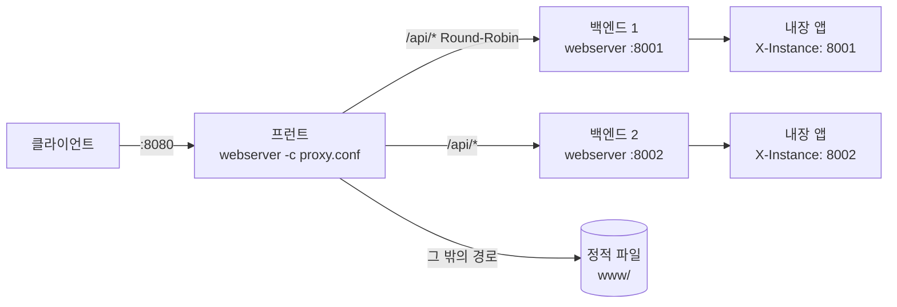
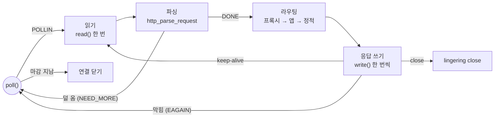
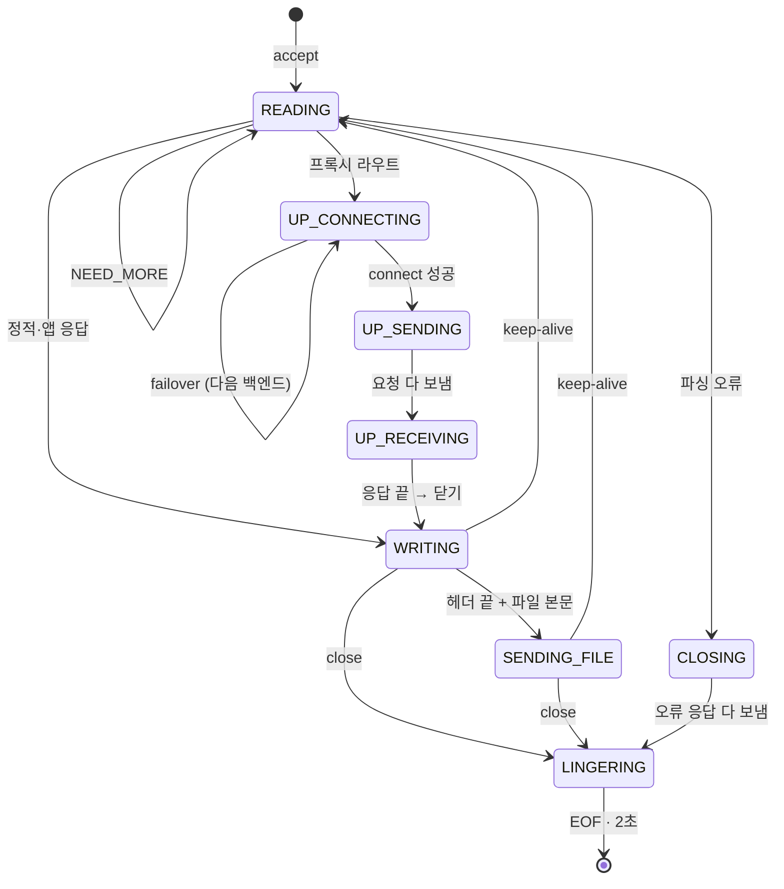

# jungle-webserver

[](https://github.com/stereokkh/jungle-webserver/actions/workflows/ci.yml)


외부 HTTP 라이브러리 없이 **POSIX 소켓 API만으로** 만든 C 웹서버 + Reverse Proxy.
CS:APP 11장의 Tiny 웹서버에서 출발해, Tiny 가 멈추거나 죽던 경우를 하나씩 재현하고 고쳤다.

## 목차

1. [한눈에 보기](#1-한눈에-보기)
2. [바로 실행해 보기](#2-바로-실행해-보기)
3. [동작 방식](#3-동작-방식)
4. [요청 처리 세 갈래](#4-요청-처리-세-갈래) — [정적 파일](#4-1-정적-파일) · [동적 처리](#4-2-동적-처리-내장-앱) · [Reverse Proxy](#4-3-reverse-proxy)
5. [다른 방식과 비교](#5-다른-방식과-비교)
6. [더 보기](#더-보기)

---

## 1. 한눈에 보기



- **이벤트 루프 하나**: 프로세스·스레드 하나가 `poll()` 로 연결 최대 1024개를 논블로킹으로 처리한다. 아무것도 안 보내는 연결이 있어도 다른 요청은 멈추지 않는다
- **같은 바이너리로 프런트와 백엔드**: `-c` 를 주면 프런트(Reverse Proxy), 안 주면 백엔드. Round-Robin 분산, connect 단계의 failover
- **세 갈래 처리**: 프록시 → 내장 앱(`/api/`) → 정적 파일 순서로 라우팅. 헬스체크 `/healthz` 만은 프록시보다 먼저 자기 자신이 답한다
- **Tiny 에서 고친 것**: 블로킹 대기, SIGPIPE 로 인한 종료, `../` 경로 탈출, 오류 페이지의 반사형 XSS 등 재현한 11가지 ([docs/classic.md](docs/classic.md))

**안 하는 것**: CGI, Forward Proxy, 캐시, TLS, chunked 본문, 요청을 백엔드에 보낸 뒤의 재시도 → [지원 범위](docs/api.md#지원하는-http-범위)

## 2. 바로 실행해 보기

```bash
make
./webserver -p 8080 -r www                  # 정적 파일 + 내장 앱
curl localhost:8080/                        # www/index.html
curl localhost:8080/healthz                 # ok (헬스체크)
curl -X POST --data hi localhost:8080/api/echo   # hi
```

프런트 1대 + 백엔드 2대로 Reverse Proxy 띄우기:

```bash
./webserver -p 8001 -r www &
./webserver -p 8002 -r www &
echo '/api 127.0.0.1:8001 127.0.0.1:8002' > proxy.conf
./webserver -p 8080 -r www -c proxy.conf &

for i in 1 2 3 4; do curl -si -X POST --data hi localhost:8080/api/echo | grep X-Instance; done
# X-Instance 가 8001, 8002 로 번갈아 바뀐다
```

<details>
<summary>옵션 전체 · 시연 페이지</summary>

```bash
./webserver -p <port> -r <docroot> [-c <proxy.conf>] [--merge-slashes] [--access-log]
```

| 옵션 | 뜻 |
|---|---|
| `-p` | 듣는 포트 (1-65535). 앱 응답의 `X-Instance` 값으로도 쓰인다 |
| `-r` | 정적 파일 루트 폴더 |
| `-c` | Reverse Proxy 설정 파일. 형식이 틀리면 `파일:줄: 이유` 를 찍고 시작하지 않는다 |
| `--merge-slashes` | 경로의 `//` 를 400 대신 `/` 로 합친다 (nginx `merge_slashes` 와 같지만 기본값이 반대) |
| `--access-log` | 연결 열림·요청·닫힘을 stderr 에 한 줄씩 |

`Ctrl-C`(SIGINT)·SIGTERM 이면 새 연결을 막고 열린 연결을 정리한 뒤 exit 0.

**시연 페이지**: `sh docs/demo/run-local.sh` 는 백엔드 3대(하나는 백업) + 프런트 1대를 띄우고, 요청 하나가 서버를 지나가는 길을 보여 주는 페이지를 실서버 모드로 연다.

</details>

## 3. 동작 방식



- **소켓·시간·상태는 `server.c` 하나가 갖는다.** 파서·응답·정적 파일·앱·프록시 정책은 "바이트 → 바이트" 함수라서 서버를 띄우지 않고 단위 테스트한다
- **`read`·`write` 는 부를 때마다 한 번.** 막히면 루프로 돌아가고 다른 연결을 처리한다. 파서는 상태를 저장하지 않아 덜 온 요청은 더 읽은 뒤 처음부터 다시 보고, 본문만 남았으면 다 모일 때까지 파서를 부르지 않는다 ([#24](docs/decisions.md))
- **경로는 파서가 정규형 하나로 만든다.** 라우팅·앱·백엔드 전달이 모두 그 문자열을 써서 `/%61pi/echo`, `//api/echo` 같은 표기로 프록시 라우트를 건너뛸 수 없다 ([#31](docs/decisions.md))
- **타임아웃은 타이머 스레드 없이** 가장 이른 마감을 `poll()` 대기 시간으로 쓴다. 유휴 10초, 요청 하나 30초(slow loris), 업스트림 5초

<details>
<summary>연결 상태 머신</summary>



</details>

<details>
<summary>HTTP 지원 범위</summary>

| 항목 | 지원 |
|---|---|
| 버전 | HTTP/1.0, 1.1 (그 외 505) |
| 연결 | 1.1 은 keep-alive 기본, 1.0 은 close 기본, `Connection` 헤더를 따름. 파이프라이닝 |
| 경계 | `\r\n\r\n` 으로 헤더 끝, `Content-Length` 로 본문 끝. `Transfer-Encoding` 은 501 |
| 한도 | 요청 대상 2KB (414), 요청 줄 + 헤더 8KB (431), 본문 1MB (413) |
| 검사 | 1.1 인데 `Host` 없음·중복 400, `Content-Length` 중복 400, 헤더 값의 제어 문자 400 |

전체: [docs/api.md](docs/api.md#지원하는-http-범위)

</details>

**자세히 →** [docs/architecture.md](docs/architecture.md) · 이벤트 루프, 상태 머신, 버퍼, 타임아웃

## 4. 요청 처리 세 갈래

`handler_route()` 가 요청 하나를 셋 중 하나로 보낸다. `-c` 가 없으면 프록시 검사는 건너뛴다.

### 4-1. 정적 파일

- GET·HEAD. 폴더면 `index.html`, 마지막 확장자로 Content-Type
- docroot 밖(`..`, 바깥을 가리키는 심볼릭 링크)은 파일이 **있든 없든 같은 403** 이라 바깥 파일의 존재가 새지 않는다
- 헤더만 버퍼에 쓰고 본문은 파일에서 16KB 조각씩 `pread` + `write`. 막히면 루프로 돌아가므로 큰 파일도 메모리에 올리지 않는다

**자세히 →** [architecture: 정적 파일](docs/architecture.md#4-1-정적-파일) · [api: 정적 파일](docs/api.md#정적-파일)

### 4-2. 동적 처리 (내장 앱)

- `GET /healthz` → `ok` (헬스체크, 프록시보다 먼저 봐서 프런트든 백엔드든 자기 자신이 답함), `POST /api/echo` → 받은 본문 그대로
- CGI(`fork`·`exec`) 대신 **서버 안의 함수 호출**. 이벤트 루프 안에서 자식 프로세스와 파이프를 기다리면 서버 전체가 멈출 수 있어서다
- 헬스체크·앱 응답에는 `X-Instance: <포트>` 가 붙어 프록시 뒤에서 어느 백엔드가 답했는지 보인다

**자세히 →** [architecture: 내장 앱](docs/architecture.md#4-2-동적-처리-내장-앱) · [api: 내장 앱](docs/api.md#내장-앱-api)

### 4-3. Reverse Proxy

- 설정 한 줄 `/api 127.0.0.1:8001 127.0.0.1:8002`. 경로 경계에서 가장 긴 접두사가 이긴다
- Round-Robin. `failover=` · `backup=` · `tries=` 를 주면 **connect 단계에서만** 다음 백엔드로 넘긴다. 요청을 보낸 뒤에는 넘기지 않아 POST 가 두 번 실행되지 않는다
- 업스트림 소켓도 같은 `poll()` 루프에서 논블로킹. 클라이언트가 느리면 업스트림 읽기를 멈춘다 (역압력, 64KB)
- 응답이 시작되기 전의 실패는 502/504, 시작된 뒤의 실패는 받은 데까지 보내고 닫는다

**자세히 →** [architecture: Reverse Proxy](docs/architecture.md#4-3-reverse-proxy) · [api: 설정 형식과 옵션](docs/api.md#reverse-proxy--c)

## 5. 다른 방식과 비교

| 비교 축 | 우리 선택 | 비교 대상 |
|---|---|---|
| 출발점 | 이벤트 루프 + 증분 파서 | CS:APP Tiny (블로킹, 한 번에 연결 하나) |
| 동시성 모델 | `poll()` 단일 스레드 | fork / 스레드 / epoll·kqueue |
| 동적 처리 | 함수 호출 + Reverse Proxy | CGI / FastCGI |
| 정적 전송 | `pread` + `write` 조각 | `mmap` 한 번 / `sendfile` |
| 운영 서버와 다르게 정한 것 | `//` 기본 400 등 | nginx |

같은 기계에서 4KB 파일, 연결 재사용 없음, 동시성 100 기준으로 우리 서버 약 4.8만, Tiny 약 1.1만 요청/초를 관찰했다. 구현이 여러 군데 달라 차이의 원인은 나누지 않았다 ([docs/benchmark.md](docs/benchmark.md)).

**자세히 →** [docs/comparison.md](docs/comparison.md)

---

## 더 보기

| 문서 | 내용 |
|---|---|
| [docs/architecture.md](docs/architecture.md) | 모듈 지도, 이벤트 루프, 상태 머신, 세 갈래 처리, 버퍼·오류 처리 원칙 |
| [docs/comparison.md](docs/comparison.md) | Tiny · 동시성 모델 · 동적 처리 방식 · 정적 전송 · nginx 와 비교 |
| [docs/api.md](docs/api.md) | 사용법, HTTP 지원 범위, 프록시 설정, 운영 제약 |
| [docs/decisions.md](docs/decisions.md) | 결정 기록 (무엇을 왜 그렇게 정했나) |
| [docs/interfaces.md](docs/interfaces.md) | 모듈 사이 약속 (반환값, 버퍼 소유권) |
| [docs/benchmark.md](docs/benchmark.md) | 처리량·느린 연결·프록시 경유 측정 |
| [docs/classic.md](docs/classic.md) | Tiny 재현 기록과 고친 곳 |
| [CONTRIBUTING.md](CONTRIBUTING.md) | 개발 환경, 테스트, 브랜치·커밋·PR 규칙 |

**팀**: 건호 [@stereokkh](https://github.com/stereokkh) (서버 코어) · 상철 [@Shirokuma0704](https://github.com/Shirokuma0704) (HTTP 파서, Reverse Proxy) · 혜성 [@sikhesung](https://github.com/sikhesung) (응답·정적 파일·내장 앱, 검증)
