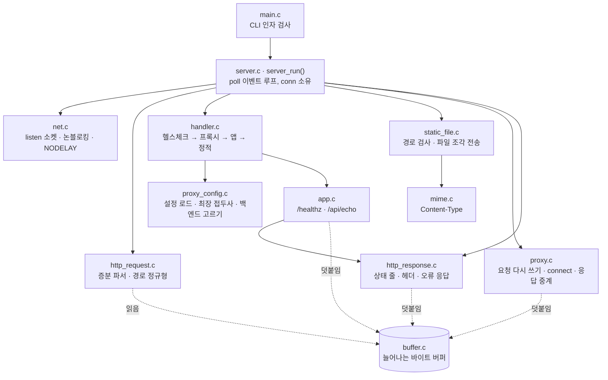
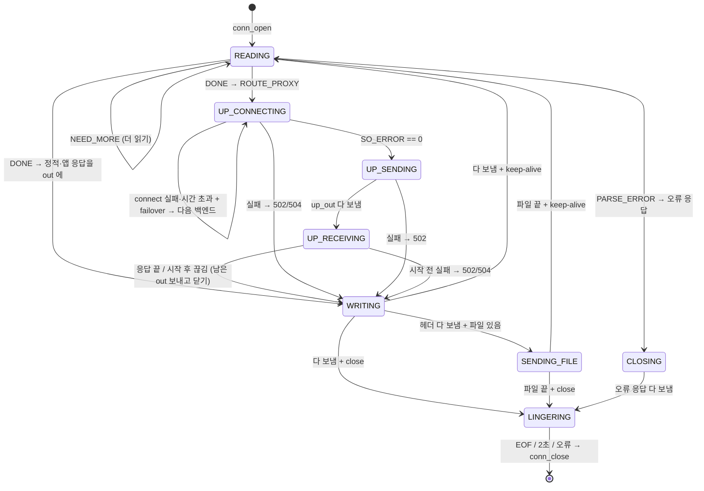
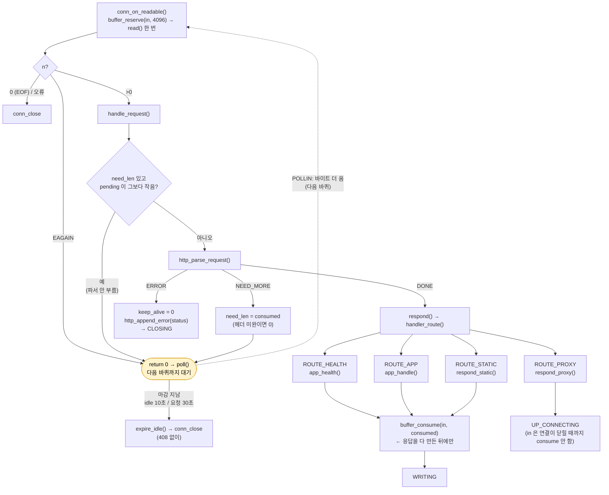
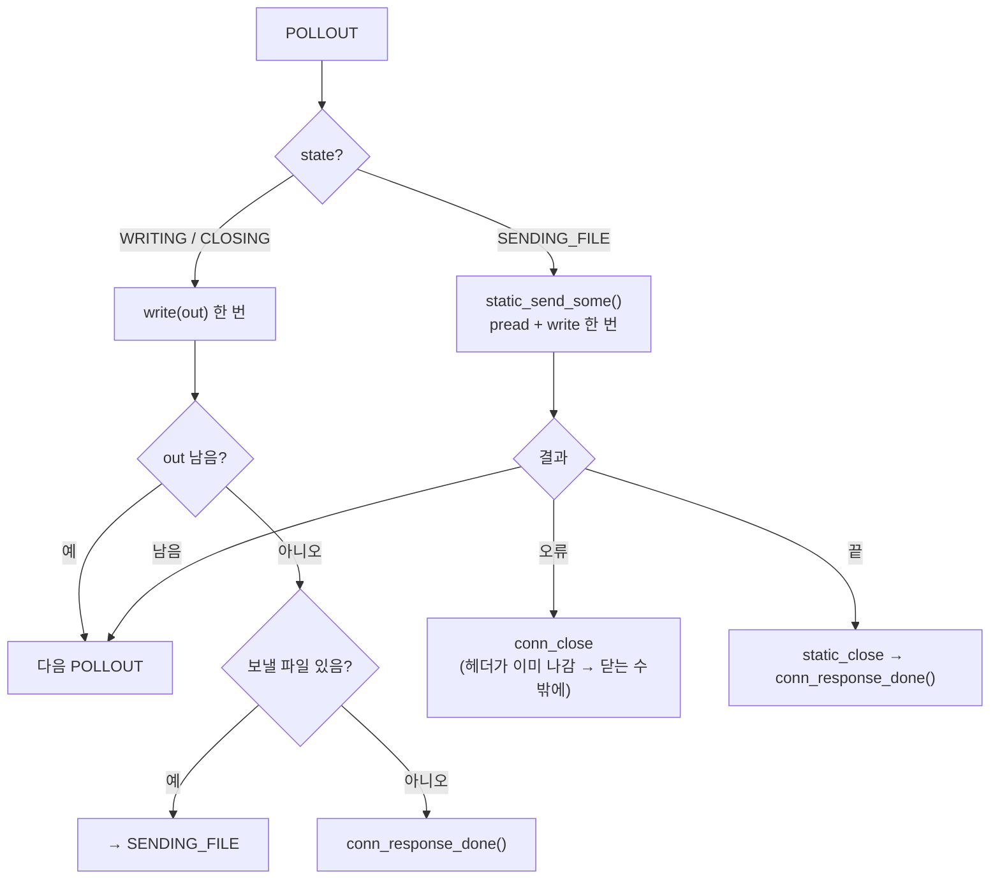
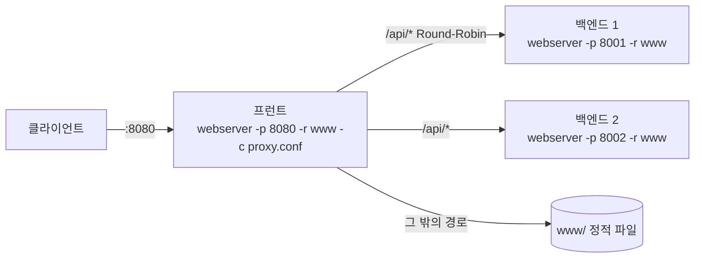
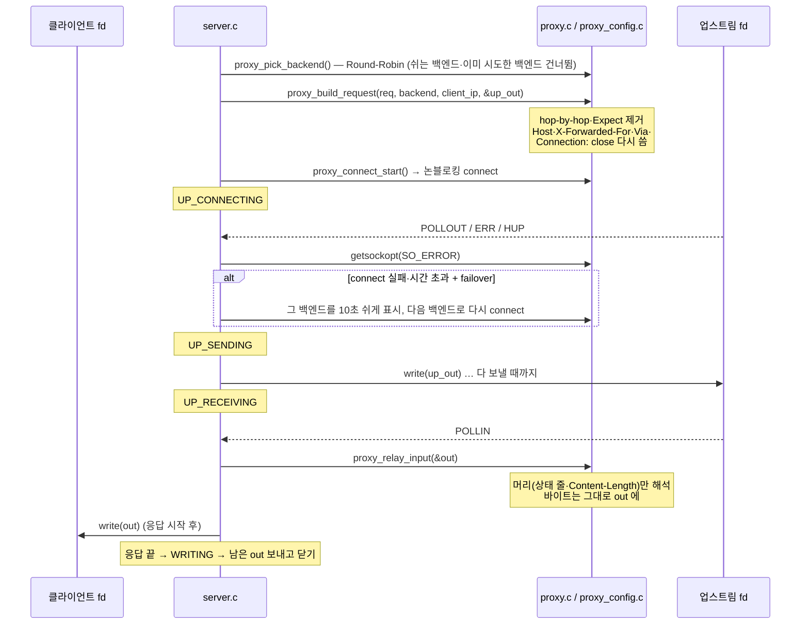

# 아키텍처

README 의 "동작 방식"과 "요청 처리 네 갈래"를 코드 수준으로 연 문서다. `./webserver -p 8080 -r www` 를 친 순간부터 종료까지 어떤 함수를 어떤 순서로 지나가는지 따라간다. 함수 이름으로 찾으면 코드와 나란히 볼 수 있다. 사용법은 [api.md](api.md), 모듈 사이 약속은 [interfaces.md](interfaces.md), 결정 이유는 [decisions.md](decisions.md).

## 목차

1. [모듈 지도](#1-모듈-지도)
2. [시작과 종료](#2-시작과-종료)
3. [동작 방식](#3-동작-방식)
   - [3-1. 이벤트 루프 한 바퀴](#3-1-이벤트-루프-한-바퀴)
   - [3-2. 연결과 상태 머신](#3-2-연결과-상태-머신)
   - [3-3. 요청 읽기와 파싱](#3-3-요청-읽기와-파싱)
   - [3-4. 응답 쓰기 · keep-alive · 닫기](#3-4-응답-쓰기--keep-alive--닫기)
   - [3-5. 타임아웃](#3-5-타임아웃)
4. [요청 처리 네 갈래](#4-요청-처리-네-갈래)
   - [4-1. 정적 파일](#4-1-정적-파일)
   - [4-2. 동적 처리 (내장 앱)](#4-2-동적-처리-내장-앱)
   - [4-3. Reverse Proxy](#4-3-reverse-proxy)
5. [버퍼와 소유권](#5-버퍼와-소유권)
6. [오류 처리 원칙](#6-오류-처리-원칙)

---

## 1. 모듈 지도



| 층 | 파일 | 하는 일 | 소켓을 아나? |
|---|---|---|---|
| 진입 | `main.c` | 인자 검사 후 `server_run` | 아니오 |
| 코어 | `server.c`, `net.c` | poll 루프, 연결 상태 머신, 타임아웃, 시그널, 업스트림 fd, 접근 로그 | **예 (유일)** |
| 라우팅 | `handler.c` | 요청 하나를 `ROUTE_HEALTH / PROXY / APP / STATIC` 중 하나로 | 아니오 |
| 처리 모듈 | `http_request`, `http_response`, `static_file`, `mime`, `app`, `proxy_config`, `proxy` | 파싱, 응답 조립, 파일, 앱, 프록시 정책·중계 | `proxy_connect_*` 만 예외 |
| 공통 | `buffer.c` | 입력·출력 버퍼, `mark` / `rollback` | 아니오 |

> [!IMPORTANT]
> **소켓·시간·상태는 전부 `server.c` 가 갖고, 나머지 모듈은 "바이트 → 바이트" 함수다.** 그래서 파서·응답·정적·앱·프록시 정책은 서버를 띄우지 않고 `tests/unit/test_*.c` 로 테스트한다. Tiny 의 `doit()` 한 함수가 하던 일을 이렇게 나눴다.

## 2. 시작과 종료

**시작**: `main()` 이 인자를 검사하고(포트 1-65535·앞자리 0 거절, docroot 가 폴더인지) 하나라도 틀리면 서버를 띄우기 전에 exit 1. 통과하면 `server_run()` 이 아래 순서로 초기화한다.

| 순서 | 호출 | 하는 일 | 실패하면 |
|---|---|---|---|
| 1 | `calloc(server)` | 서버 전체 상태(`conns[1024]`, pollfd 배열 등)를 힙에 | -1 |
| 2 | `proxy_config_load()` | `-c` 가 있을 때만. 설정 파싱, 백엔드 이름을 여기서 한 번만 `getaddrinfo` | 시작 안 함 |
| 3 | `setup_signals()` | self-pipe, `SIGPIPE` 무시, `SIGINT`·`SIGTERM` 핸들러 | -1 |
| 4 | `net_listen(port)` | listen 소켓 | -1 (`EADDRINUSE` 등 출력) |
| 5 | `while (!stop_requested)` | 이벤트 루프 → [3-1](#3-1-이벤트-루프-한-바퀴) | |

- **self-pipe**: 시그널 핸들러는 `stop_requested = 1` 과 파이프에 1바이트 쓰기만 한다. "플래그 검사 → `poll` 진입" 사이에 시그널이 오면 플래그만으로는 다음 이벤트까지 묻히는데, 파이프에 바이트가 있으면 `poll` 이 바로 깬다
- **`SIGPIPE` 무시**: 끊긴 소켓에 `write` 하면 프로세스가 죽는 대신 `EPIPE` 를 받아 그 연결만 닫는다 (Tiny 는 여기서 죽었다). `MSG_NOSIGNAL` 은 Linux 전용이라 쓰지 않는다
- **`net_listen()`** 은 Tiny 의 `open_listenfd` 를 고친 것이다: 실패하면 exit 대신 -1, IPv6 소켓 하나로 IPv4 까지 받음(`IPV6_V6ONLY = 0` 명시), listen 소켓도 논블로킹

**종료**: 시그널로 루프를 빠져나오면 `shutdown_all()` 이 listen 소켓을 먼저 닫고(새 연결 차단), 모든 연결을 `conn_close()` 로 정리한 뒤 exit 0.

## 3. 동작 방식

### 3-1. 이벤트 루프 한 바퀴

```c
while (!stop_requested) {
    next = expire_idle(s, now_ms());              // 1. 마감 지난 연결 정리 + 다음 마감
    npfds = build_pollfds(s);                     // 2. pollfd 배열을 매번 새로
    rc = poll(s->pfds, npfds, poll_timeout_ms(next)); // 3. 기다림
    if (rc < 0 && errno == EINTR) continue;       //    시그널 → 루프 조건에서 확인
    if (rc > 0) dispatch(s, npfds);               // 4. 연결 이벤트 → 시그널 파이프 → accept
}
```

| pollfd 칸 | fd | 감시 |
|---|---|---|
| `[0]` | 시그널 파이프 읽기 끝 | `POLLIN` |
| `[1]` | listen fd (accept 를 쉬는 중이면 `-1` → poll 이 무시) | `POLLIN` |
| `[2..]` | 연결마다 클라이언트 fd 한 칸, 프록시 중이면 업스트림 fd 까지 두 칸 | 상태에 따라 하나 |

- **accept 는 맨 마지막.** 먼저 하면 방금 닫은 `conns[]` 칸에 새 연결이 들어가서, 같은 칸을 가리키던 이전 pollfd 의 `revents` 가 새 연결에 잘못 적용될 수 있다
- **`accept_ready()`** 는 한 바퀴에 최대 64개만 받는다 (대기열이 계속 차 있어도 기존 연결·타임아웃·종료가 밀리지 않게). fd 가 바닥나면(`EMFILE`·`ENFILE`) Tiny 처럼 죽지 않고 100ms 동안 listen fd 를 poll 에서 뺀다. 안 그러면 대기열 때문에 poll 이 계속 깨어나 CPU 를 다 쓴다. 연결 하나가 닫히면 바로 재개한다

### 3-2. 연결과 상태 머신

`conn_open()` 은 소켓을 논블로킹 + `TCP_NODELAY` 로 바꾸고(#43: keep-alive 정적 파일의 요청당 44ms 멈춤 해결), `conn` 을 힙에 만들어 `READING` 으로 시작한다.

| `conn` 주요 필드 | 뜻 |
|---|---|
| `fd`, `state` | 클라이언트 소켓, 지금 상태 |
| `in` | 받은 바이트. 파서는 여기를 본다 |
| `out` | 보낼 바이트. `out.off` 가 송신 진행 상태 (short write 면 여기서 이어감) |
| `req` | 파서 결과. `headers`·`body` 는 `in` 안을 가리킨다 |
| `keep_alive` | 이번 응답 뒤 연결 유지 여부 |
| `file` | 정적 파일 fd·크기·보낸 위치 |
| `need_len` | 본문 대기 중이면 요청 전체 길이. 그만큼 모일 때까지 파서를 부르지 않는다 |
| `upstream_fd`, `up_out`, `relay` | 프록시: 백엔드 소켓, 다시 쓴 요청, 응답 해석 상태 |
| `up_tried`, `up_ntries` | 프록시 failover: 이번 요청에 시도한 백엔드 |
| `last_active_ms`, `req_start_ms`, `up_*_ms` | 타임아웃 시계 → [3-5](#3-5-타임아웃) |



| 상태 | 감시하는 이벤트 |
|---|---|
| `READING`, `LINGERING` | 클라이언트 `POLLIN` |
| `WRITING`, `SENDING_FILE`, `CLOSING` | 클라이언트 `POLLOUT` |
| `UP_CONNECTING`, `UP_SENDING` | 업스트림 `POLLOUT` (클라이언트는 `events = 0`, 끊김만 감지) |
| `UP_RECEIVING` | 업스트림 `POLLIN` + `out` 에 바이트가 있으면 클라이언트 `POLLOUT` |

> [!TIP]
> **한 번에 한 방향만 감시한다.** 응답을 보내는 동안에는 클라이언트 소켓을 읽지 않는다. 그래서 파이프라이닝으로 미리 온 다음 요청은 `in` 에 남아 있다가 응답이 끝난 뒤 처리된다 → [3-4](#3-4-응답-쓰기--keep-alive--닫기)

### 3-3. 요청 읽기와 파싱



- `read`·`write` 는 부를 때마다 시스템 콜 한 번. 막히면(`EAGAIN`) 바로 루프로 돌아간다
- NEED_MORE 도 `handle_request()` 안에서 다시 돌지 않는다. `return 0` 으로 poll 에 돌아가고, 다음 POLLIN → read → `handle_request()` 가 루프 여러 바퀴에 걸쳐 반복된다
  - 본문만 덜 옴: `need_len` = 요청 전체 길이. 그만큼 모일 때까지 `http_parse_request()` 를 부르지 않는다 (PR #24)
  - 헤더도 덜 옴: `need_len = 0` → read 할 때마다 다시 파싱 (헤더는 최대 8KB 라 싸다)
- 끝내 다 안 오면 `expire_idle()` 이 닫는다. `req_start_ms` 는 read 마다 갱신되지 않고 요청이 끝나야(DONE·ERROR) 초기화되므로, 1바이트씩 흘려 유휴 시계를 피해도 30초면 끊긴다
- `consume` 을 응답을 만든 **뒤에** 하는 이유: `req.headers`·`req.body` 가 `in` 안을 가리키는 포인터라서. 먼저 consume 하거나 `in` 에 read 하면 compact·realloc 으로 포인터가 무효가 된다

**파서가 지키는 것** (`http_request.c`, 상태를 저장하지 않고 매번 버퍼 처음부터):

| 경계·규칙 | 처리 |
|---|---|
| 요청 앞 빈 줄 | 건너뜀 (RFC 9112 2.2) |
| 헤더 끝 | 앞 8KB 안에서만 `\r\n\r\n` 을 찾음. 없고 8KB 미만이면 NEED_MORE, 넘으면 **다른 오류보다 먼저 431** (TCP 분할과 상관없이 같은 요청은 같은 코드) |
| 요청 줄 | 첫 `\r\n` 까지. 버전 1.0·1.1 외 505, 모르는 메서드 501, 대상 2KB 초과 414 |
| 헤더 줄 | `\r\n` 단위. 줄 안의 맨 CR·LF, 이어 쓰기 줄, 값의 제어 문자는 400 |
| `Host` | HTTP/1.1 인데 없거나 두 개면 400 |
| 본문 | `Content-Length` 만큼 (숫자만, 두 줄이면 값이 같아도 400, 1MB 초과 413). `Transfer-Encoding` 은 501 |
| keep-alive | 1.1 은 유지, 1.0 은 닫음이 기본. `Connection` 토큰에 `close` 가 있으면 닫음, `keep-alive` 면 유지 |

**경로 정규형 (#31)**: 파서가 `target` 을 정규형 하나로 만들고 라우팅·앱·백엔드 전달이 모두 그 문자열을 쓴다. 정적 파일만 이를 끝까지 디코딩한 `path` 를 쓴다.

1. `%XX` 문법 오류 → 400
2. 인코딩 안 된 `\`, 디코딩하면 `/`·`\`·NUL·제어 문자가 되는 `%XX` → 400
3. 빈 조각 `//` → 400 (`--merge-slashes` 면 합침)
4. 비예약 문자의 `%XX` 만 글자로, 나머지는 대문자 (`/%61pi/a%eb` → `/api/a%EB`)
5. `.`·`..` 조각 → 400

그래서 `/%61pi/add` 로 표기를 바꿔도 `/api` 프록시 라우트를 건너뛸 수 없다.

### 3-4. 응답 쓰기 · keep-alive · 닫기



- short write 는 `out.off`(버퍼)와 `file.offset`(파일)에 진행 상태를 저장하고 다음 POLLOUT 에서 이어간다
- 파일을 다 보내면 바로 `static_close`. keep-alive 다음 요청의 `static_open` 이 덮어쓰면 fd 가 샌다

**`conn_response_done()`**: `CLOSING` 이거나 `keep_alive == 0` 이면 lingering close. 아니면 `READING` 으로 돌아가고, `in` 에 다음 요청이 이미 있으면 **기다리지 않고 바로** `handle_request()` 를 부른다. 다음 요청이 이미 버퍼에 다 와 있으면 소켓에는 새 바이트가 없어서, level-triggered `poll` 은 깨워 주지 않는다. 직접 부르지 않으면 그 요청은 멈춘다.

**lingering close (`conn_linger()`)**: `shutdown(fd, SHUT_WR)` 로 송신만 닫고, 들어오는 바이트는 읽어서 버리다가 EOF·오류·2초 중 먼저 오는 것에 닫는다. 읽지 않은 입력이 남은 채 바로 `close` 하면 커널이 RST 를 보내고, 클라이언트는 아직 안 읽은 응답(413, 431 같은 오류 응답)까지 버린다.

**`conn_close()`**: 소켓·업스트림 소켓·파일·버퍼·중계 상태를 정리하는 곳은 이 함수 하나뿐이다. 정리 함수는 모두 두 번 불러도 안전하다. 닫으면 쉬던 accept 를 재개한다.

**접근 로그 (`--access-log`)**: 연결 열림·요청·닫힘 이유를 stderr 에 한 줄씩 쓴다. 요청 줄은 응답을 다 보낸 뒤에 쓰고, 닫힘 이유는 `done`, `client-closed`, `idle-timeout`, `request-timeout`, `linger-timeout`, `read-error`, `write-error`, `event-error`(이벤트 백엔드 등록 실패), `shutdown`. stderr 를 받는 쪽이 막히면 루프도 멈추므로 관찰할 때만 켠다.

### 3-5. 타임아웃

| 매크로 | 값 | 언제부터 | 넘으면 |
|---|---|---|---|
| `CLIENT_IDLE_TIMEOUT_MS` | 10초 | 마지막으로 바이트가 오간 때 | 닫기 (keep-alive 유휴, 덜 보내고 멈춘 클라이언트) |
| `CLIENT_REQUEST_TIMEOUT_MS` | 30초 | 지금 요청의 **첫 바이트** | 응답 없이 닫기 (slow loris) |
| `CLIENT_LINGER_TIMEOUT_MS` | 2초 | `shutdown(SHUT_WR)` | 닫기 |
| `UPSTREAM_TIMEOUT_MS` | 5초 | 응답 시작 전: 프록시에 넘긴 때 / 시작 후: 마지막 업스트림 바이트 | 시작 전 504 / 시작 후 남은 out 보내고 닫기 |
| `PROXY_CONNECT_TIMEOUT_MS` | 1초 | 이번 시도의 connect 시작 | `failover=timeout` 라우트에서만 잼 → 다음 백엔드 (아니면 전체 마감 5초까지 기다림) |
| `PROXY_BACKEND_DOWN_MS` | 10초 | connect 오류·시간 초과가 난 때 | 그동안 그 백엔드를 고르지 않음 (failover 라우트만) |

- `conn_deadline()` 이 상태별로 가장 이른 마감을 계산하고, `expire_idle()` 이 전체 연결을 돌며 지난 것은 닫고, 남은 것 중 최소값을 `poll` 대기 시간으로 쓴다. 타이머 스레드가 없다
- 시계는 `CLOCK_MONOTONIC`. 벽시계는 시스템 시간을 바꾸면 뒤로 간다
- 업스트림 상한이 클라이언트 유휴보다 길면 클라이언트가 먼저 만료돼 504 대신 그냥 끊기므로, `UPSTREAM_TIMEOUT_MS >= CLIENT_IDLE_TIMEOUT_MS` 면 빌드에서 `#error` 로 막는다

## 4. 요청 처리 네 갈래

```c
// handler_route()
if (app_health_match(req))                                      return ROUTE_HEALTH; // 정확히 "/healthz"
if (cfg != NULL && (*route = proxy_match(cfg, req->target)))  return ROUTE_PROXY;
if (app_match(req))                                             return ROUTE_APP;   // "/api/" 로 시작
return ROUTE_STATIC;
```

- 프록시 매칭: 정규형 `target` 의 `?` 앞 경로, **경로 경계에서만** (`/api` 는 `/apix` 에 안 맞음), 가장 긴 접두사가 이긴다
- 헬스체크가 프록시보다 먼저인 이유: "이 인스턴스가 살아 있나"를 묻는 주소라서, 프런트에 보낸 것을 백엔드가 대신 답하면 안 된다. 정확 일치라 프록시 라우트(`/` 포함)를 가로채는 것은 이 한 경로뿐이다 (`/healthz/x`, `/healthzz` 는 평소 순서로)
- 프록시가 앱보다 먼저인 이유: 프런트(`-c` 있음)에서는 `/api/` 가 백엔드로 가고, 백엔드(`-c` 없음)에서는 같은 경로를 앱이 처리한다. 같은 바이너리로 프록시 순환 없이 프런트·백엔드를 다 띄우기 위해서다
- Tiny 는 `strstr(uri, "cgi-bin")` 이라 경로 어디에든 그 글자가 있으면 동적으로 오판했다

### 4-1. 정적 파일

`respond_static()`:

1. GET·HEAD 가 아니면 405 + `Allow: GET, HEAD`
2. `static_open(docroot, req.path, ...)`
   - `.`·`..`·`//` 를 글자 단위로 정리해 루트 위로 가면 **파일이 있든 없든 403**
   - `realpath` 결과가 docroot 밖이면(심볼릭 링크) 403
   - 폴더면 `index.html` (없으면 404), 일반 파일이 아니면 403 (FIFO 를 열다 멈추지 않게)
   - `open` → `fstat` 크기 → `mime_type()` (마지막 `.` 뒤, 대소문자 무시, 모르면 `application/octet-stream`)
3. 응답 헤더만 `out` 에 쓴다. 본문은 나중에 `SENDING_FILE` 에서 파일에서 직접
4. HEAD 면 파일을 바로 닫는다 (헤더는 GET 과 같고 본문 없음)

본문은 `static_send_some()` 이 16KB 이하 지역 버퍼로 `pread` + `write` 를 한 번씩 한다. Tiny 처럼 파일 전체를 `mmap` 해서 다 쓸 때까지 막히지 않고, 큰 파일도 메모리에 다 올리지 않는다. `sendfile` 은 OS 마다 시그니처가 달라 쓰지 않았다 ([comparison.md](comparison.md#4-정적-전송)).

### 4-2. 동적 처리 (내장 앱)

`app_handle(req, port, &out)` — Tiny 의 `serve_dynamic` + `adder.c` 자리를 CGI 대신 함수로 옮긴 것. 덧셈(`/api/add`)은 2026-11-25 에 헬스체크(`/healthz`)로 바꿨다 (#53).

| 요청 | 응답 |
|---|---|
| `GET`·`HEAD /healthz` | 200 `ok` (다른 메서드 405). 정확히 `/healthz` 일 때만, **프록시 라우트보다 먼저** 본다 |
| `POST /api/echo` | 200 받은 본문 그대로 |
| 그 밖의 `/api/` | 404, 메서드가 틀리면 405 |

- 헬스체크와 앱까지 온 모든 응답(오류 포함)에 `X-Instance: <포트>` 를 붙인다. 프록시 뒤에서 Round-Robin 분산을 눈으로 확인하는 용도다
- CGI 를 하지 않은 이유: `poll` 루프 안에서 자식 프로세스의 파이프와 `waitpid` 를 다루다 실수하면 서버 전체가 멈춘다. 4.5일 일정에서 이 위험을 지는 대신, 확장은 Reverse Proxy 로 하기로 했다 ([comparison.md](comparison.md#3-동적-처리-방식))

### 4-3. Reverse Proxy

**배포 구성**: 같은 바이너리 셋.



```text
# proxy.conf — 한 줄에 "접두사 host:port... [옵션...]"
/api 127.0.0.1:8001 127.0.0.1:8002
/ha  127.0.0.1:8001 127.0.0.1:8002 backup=127.0.0.1:8003 failover=connect,timeout tries=3
```

- 접두사는 정규형이어야 한다 (`%`·`?`·`//`·`..` 가 있으면 시작 거부, PR #41). 정규형 `target` 에 나올 수 없는 모양은 어떤 요청에도 맞지 않기 때문이다
- 한도: 라우트 16, 라우트당 백엔드 8. 이름은 시작할 때 한 번 해석, IPv4 우선
- 요청 대상은 **접두사를 떼지 않고** 정규형 그대로 보낸다

**흐름**:



**failover** (`failover=` 가 있는 라우트만): 요청 바이트는 `UP_SENDING` 부터 나가므로, 그 전인 connect 단계의 실패에서만 다음 백엔드로 넘긴다. 그래서 POST 도 같은 요청이 두 백엔드에서 실행되지 않는다. 시도 횟수는 `tries=`(없으면 백엔드 전부)로 막고, 전체 마감 5초는 첫 시도부터 한 번만 잰다. 주 백엔드를 다 시도했거나 모두 쉬는 중이면 `backup=` 을 적은 순서로 쓴다.

| 실패 지점 | 결과 |
|---|---|
| 다시 쓴 머리가 8KB 초과 | 431 |
| connect 오류·업스트림 쓰기 오류 (넘길 수 없을 때) | 502 |
| connect 시간 초과 (넘길 수 없을 때), 응답 시작 전 5초 초과 | 504 |
| 응답 시작 전 깨진 머리, 1xx, 끊김 | 502 |
| **응답 시작 후** 끊김·유휴 5초 | 이미 `out` 에 있는 것까지 보내고 닫기 (재시도 없음) |

- "응답 시작" = 상태 줄 검사를 통과한 머리를 `out` 에 넣은 순간. 그 전에는 상태 코드를 바꿀 수 있고, 그 뒤에는 못 바꾼다
- 프록시 응답 뒤에는 **항상 클라이언트 연결을 닫는다** (백엔드에 `Connection: close` 를 보냈으므로)

**역압력 (backpressure)**: 클라이언트가 느려서 `out` 이 64KB(`PROXY_RELAY_MAX`)까지 차면 업스트림 fd 를 poll 에서 뺀다. 그래서 버퍼 상한(4MB)보다 큰 응답도 모으지 않고 흘려보낸다. 쉬는 동안은 업스트림 유휴 시계를 세지 않는다 (그건 클라이언트 탓이니 클라이언트 유휴 시계가 맡는다).

## 5. 버퍼와 소유권

```text
data: [ 이미 소비·송신함 | 아직 남은 바이트 | 빈 공간 ]
       0                off              len        cap
```

| 자원 | 소유자 | 정리 |
|---|---|---|
| 클라이언트 소켓, `conn` | `server.c` | `conn_close` 에서만 |
| `in`, `out`, `up_out` | `conn` | `conn_close` 의 `buffer_free` |
| 정적 파일 fd | `conn.file` | `static_close` |
| 업스트림 소켓 | `conn.upstream_fd` | 응답 끝·실패 때 `up_release`, 아니면 `conn_close` |
| `proxy_config` | `server` (서버 수명) | 프로그램 종료 |

규칙 ([interfaces.md](interfaces.md)):

- 다른 모듈은 받은 `buffer` 에 **덧붙이기만** 한다. free·clear·consume 금지
- 덧붙이기가 실패하면 버퍼는 호출 전 그대로. 여러 번 나눠 쓰면 `buffer_mark` → 실패 시 `buffer_rollback` (반쯤 쓴 응답이 나가지 않게)
- 상한 `BUFFER_MAX` 4MB. Tiny 처럼 고정 배열 + `sprintf` 가 아니다
- 모듈은 자기가 열지 않은 fd 를 닫지 않는다
- 큰 구조체(`server`, `conn`, `http_request`)는 스택이 아니라 힙에 둔다 (musl 의 작은 스레드 스택)

## 6. 오류 처리 원칙

| 반환 형태 | 뜻 |
|---|---|
| `int` 0 / -1 | 성공 / 실패. **4xx·5xx 응답을 "쓴 것"은 성공(0)**. -1 은 응답조차 못 쓸 때(메모리 부족)만 → 서버가 연결을 닫음 |
| `int` 1 / 0 / -1 | 끝남 / 아직 남음(EAGAIN) / 오류 (`static_send_some`) |
| `enum` | `parse_result`, `route_kind`, `proxy_relay_result` |
| fd 또는 -1 | `net_listen`, `proxy_connect_start` (`errno` 유지) |

- 연결 하나의 오류(`ECONNRESET`, `EPIPE`)는 **그 연결만** 닫는다. 프로세스 종료는 시작 단계 실패뿐이다 (Tiny 는 래퍼 함수가 오류마다 `exit` 했다)
- 송신을 시작하기 **전**의 실패는 상태 코드로 답하고, 시작한 **뒤**의 실패는 닫는 것 말고 방법이 없다 (이미 200 을 보냈으니까)
- 오류 본문에는 요청 내용을 넣지 않는다 (`<h1>404 Not Found</h1>` 만). Tiny `clienterror` 의 반사형 XSS 를 피한다
