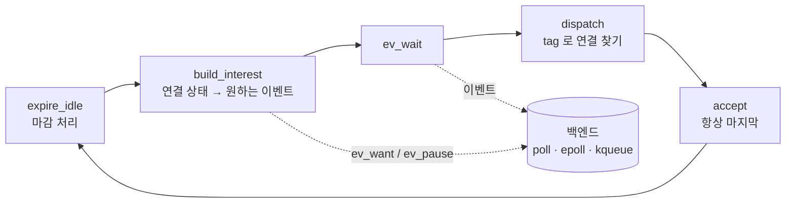

# 이벤트 백엔드 명세 (poll / epoll / kqueue)

> 상태: **제안** (상철, 2026-11-25). 트랙 A(건호) 합의 전이다. 6장의 결정 5개는 이 제안 안에서 정한 것.
> 목적: `server.c` 의 이벤트 루프를 백엔드 하나에 묶지 않고, 빌드 때 poll(기본)·epoll(Linux)·kqueue(macOS)를 고를 수 있게 한다.
> 같은 문제에 대한 다른 설계가 `feat/kqueue` (혜성, `poller.h`) 에 있다. 둘의 차이는 0장. 어느 쪽으로 갈지 정하면 다른 쪽은 닫는다.

## 0. `feat/kqueue` (poller.h) 와의 차이

| | `feat/kqueue` (`poller_wait`) | 이 제안 (`ev.h`) |
|---|---|---|
| 인터페이스 | `poller_wait(pfds, n, timeout)`: poll 과 같은 모양 | `ev_want` / `ev_pause` / `ev_forget` / `ev_wait`, 이벤트마다 tag |
| `server.c` 변경 | 2줄 (poll 호출 교체) | `build_pollfds` → `build_interest`, `dispatch`, 감시 fd 를 닫는 곳 (`close_watched`), tag·칸 세대 |
| 빌드 | `make KQUEUE=1` | `make EVENT=poll\|epoll\|kqueue` |
| kqueue 등록 | 바퀴마다 모든 fd 를 `EV_ONESHOT` 으로 다시 등록 (비용 모양이 poll 과 같다고 그 브랜치 결정 기록이 적음) | 바뀐 fd 만 고친다 (epoll 도 같은 구조) |
| 프록시 중 클라이언트 fd | kqueue 만 보지 않는다 (poll 은 events 0 으로 끊김 감지) | 세 백엔드 모두 보지 않는다 (결정 1) |
| epoll | 없음 | 같은 인터페이스의 백엔드 하나 |

- `poller_wait` 쪽 장점: 작고 리뷰가 쉽다. 기본 빌드의 `server.c` 가 거의 그대로다.
- 이 제안의 장점: 등록을 커널에 유지하는 백엔드(epoll·kqueue)가 poll 과 **다른 비용 모양**을 갖는다. 원래 목적이 poll 과 epoll/kqueue 를 연결 수별로 비교하는 것이라, 바퀴마다 다시 등록하면 비교할 차이가 구조적으로 작아진다. 세 백엔드의 동작(특히 프록시 중 클라이언트)이 같아 측정 결과를 백엔드 차이로 읽을 수 있다.
- 대가: `server.c`(트랙 A 파일) 변경이 크다.

---

## 1. 범위

- **바꾸는 것**: `server.c` 가 `poll()` 을 직접 부르던 자리를 `include/ev.h` 함수로 바꾼다. 백엔드는 `src/ev_<이름>.c` 하나씩.
- **안 바꾸는 것**: 연결 상태 기계, 타임아웃, 프록시·페일오버 동작. 단 하나의 예외는 결정 1 (프록시 중 클라이언트 fd 를 보지 않음, 세 백엔드 공통).
- **기본은 poll 그대로**: CLAUDE.md 이식성 규칙 "poll() 기본, epoll/kqueue 는 나중에 최적화로만". epoll·kqueue 는 비교 측정용 선택지다.
- **세 백엔드는 똑같이 동작해야 한다.** 비교 측정이 목적이라 동작이 다르면 결과를 해석할 수 없다. 아래 결정은 모두 이 원칙으로 골랐다.



## 2. 빌드 선택

| 명령 | 빌드되는 파일 | 플랫폼 |
|---|---|---|
| `make` (= `EVENT=poll`) | `src/ev_poll.c` | 전부 (macOS, glibc, musl) |
| `make EVENT=epoll` | `src/ev_epoll.c` | Linux |
| `make EVENT=kqueue` | `src/ev_kqueue.c` | macOS (BSD) |

- Makefile 은 `SRCS` 에서 **고르지 않은 백엔드 파일을 뺀다** (`filter-out`). 파일 전체를 `#ifdef` 로 감싸면 빈 번역 단위가 되어 `-Wpedantic -Werror` 에서 실패한다.
- 백엔드 파일은 맨 위에서 플랫폼을 검사한다: 다른 OS 에서 고르면 `#error`. OS 분기는 이 파일들 안에만 둔다 (CLAUDE.md "OS별 분기는 한 곳에").
- `EVENT` 가 비어 있으면 poll, 모르는 값이면 `$(error ...)`. (CI 행렬에 `event` 키가 없는 항목은 `EVENT=` 로 펼쳐진다. 오타가 poll 로 조용히 빌드되면 "두 백엔드 다 통과"가 같은 바이너리를 두 번 시험한 것이 된다)
- **EVENT 를 바꾸면 다시 링크돼야 한다.** 예전 백엔드의 `.o` 가 `build/` 에 남아 있고 `webserver` 가 더 새로우면 make 는 링크를 건너뛴다. 방법: 마지막 EVENT 를 적은 스탬프 파일(내용이 바뀔 때만 다시 씀)에 `$(TARGET)` 과 단위 테스트가 의존하게 한다.
- 어느 백엔드인지 눈으로 확인: 시작 줄에 이름을 찍는다 `webserver: listening on port 8080 (IPv6+IPv4, epoll), ...`
- `make asan EVENT=...` 는 하위 make 에 EVENT 가 그대로 넘어간다 (명령줄 변수).

## 3. 인터페이스 (`include/ev.h`)

```c
#define WS_EV_IN   0x1u   /* 읽기 가능 (EOF 포함) */
#define WS_EV_OUT  0x2u   /* 쓰기 가능 (논블로킹 connect 완료 포함) */
#define WS_EV_ERR  0x4u   /* 오류 (받기만 함) */
#define WS_EV_HUP  0x8u   /* 끊김 (받기만 함) */

typedef struct ev_loop ev_loop;
typedef struct { uint64_t tag; unsigned events; } ev_event;

const char *ev_backend(void);                 /* "poll" / "epoll" / "kqueue" */
ev_loop *ev_open(size_t max_watch);           /* 실패 NULL + errno */
void ev_close(ev_loop *ev);                   /* NULL 허용 */
void ev_begin(ev_loop *ev);                   /* 이번 바퀴 감시 목록 시작 */
int  ev_want(ev_loop *ev, int fd, uint64_t tag, unsigned events);
void ev_pause(ev_loop *ev, int fd);           /* 이번 바퀴에 아예 안 봄 */
void ev_forget(ev_loop *ev, int fd);          /* close 직전. NULL 허용 */
int  ev_wait(ev_loop *ev, int timeout_ms, const ev_event **out);
```

### 3-1. 함수별 계약

| 함수 | 계약 |
|---|---|
| `ev_open(max_watch)` | 한 바퀴에 감시할 fd 수의 상한이자 한 번에 돌려받는 이벤트 수의 상한. 서버는 `2 + 2 * SERVER_MAX_CONNS` (시그널 + listen + 연결마다 클라이언트·업스트림) |
| `ev_begin` | 매 바퀴 `build_interest` 맨 앞에서 부른다. poll: 배열 비움. epoll·kqueue: 할 일 없음 (등록이 커널에 남는다) |
| `ev_want(fd, tag, events)` | 이번 바퀴에 fd 를 감시한다. `events` 는 **`WS_EV_IN` 또는 `WS_EV_OUT` 정확히 하나** (결정 2). 0 이나 둘 다, 그 밖의 비트는 `errno = EINVAL` 로 -1. 등록 실패도 **그 자리에서** -1 + errno (결정 3) |
| `ev_pause(fd)` | 이번 바퀴에 fd 를 **아예** 보지 않는다. `WS_EV_ERR`·`WS_EV_HUP` 도 오면 안 된다. 등록돼 있지 않은 fd 에 불러도 된다 |
| `ev_forget(fd)` | 감시하던 fd 를 `close` 하기 **직전**에 반드시 부른다. 백엔드의 "등록돼 있음" 기록을 지운다 (3-3) |
| `ev_wait(timeout, &out)` | `timeout_ms` 는 poll 과 같다 (-1 무한, 0 바로). 반환 = 이벤트 수, 0 = 시간 초과, -1 = errno (`EINTR` 포함, 서버가 루프 조건을 다시 본다). `*out` 은 다음 `ev_wait`/`ev_begin` 까지 유효 |
| 이벤트 순서 | 정하지 않는다. poll 은 `ev_want` 순서, epoll·kqueue 는 커널이 준 순서. 서버는 순서에 기대지 않는다 (4장) |
| 같은 fd 의 이벤트 | 한 번의 `ev_wait` 결과에 **fd 하나당 최대 하나**. fd 마다 필터·이벤트를 하나만 걸므로(결정 2) kqueue 도 자연히 지켜진다 |

### 3-2. 감시 안 함 = `ev_pause`

서버가 fd 를 보지 않는 경우는 셋이고, 모두 `ev_pause` 로 한다:

| 경우 | 언제 |
|---|---|
| listen 소켓 | accept 가 fd 고갈(EMFILE 등)로 실패해 100ms 쉬는 동안 |
| 업스트림 fd | 역압력: 클라이언트 `out` 이 `PROXY_RELAY_MAX` 까지 차서 업스트림을 읽지 않는 동안 |
| 클라이언트 fd | 프록시 중(`CONN_UP_*`)에 보낼 `out` 이 없는 동안 (결정 1). 응답이 시작돼 `out` 에 바이트가 있으면 `WS_EV_OUT` |

예전 poll 코드는 앞의 둘에 음수 fd 를 넣어 poll 이 무시하게 했다. epoll 에 "이벤트 0" 으로 남겨 두면 끊긴 fd 의 `EPOLLHUP`/`EPOLLERR` 가 레벨 트리거라 계속 와서 **루프가 쉬지 못한다** (처리 함수는 읽기를 멈춘 상태라 아무것도 안 하고 돌아간다). 그래서 "이벤트 0" 은 인터페이스에서 없앴다. epoll 은 `EPOLL_CTL_DEL`, kqueue 는 걸려 있는 필터의 `EV_DELETE` 로 구현한다.

### 3-3. close 와 등록 기록

- epoll·kqueue 둘 다 fd 를 close 하면 커널이 감시 목록에서 저절로 뺀다 (서버는 fd 를 `dup`·`fork` 로 나누지 않는다).
- 그런데 백엔드가 "fd N 은 이벤트 X, tag T 로 등록됨"을 기억하고 바뀐 것만 시스템 콜로 고친다면, close 뒤 **같은 번호의 새 fd** 가 생겼을 때 "이미 등록됨"으로 보고 건너뛴다 → 그 fd 는 감시되지 않고 연결이 마감까지 멈춘다.
- 이 일이 실제로 생기는 곳: 페일오버(`up_connect_failed`)는 업스트림 fd 를 닫자마자 다음 백엔드로 새 fd 를 연다. 번호가 같기 쉽다.
- 그래서 서버는 감시 중일 수 있는 fd 를 모두 `close_watched(s, fd)` (= `ev_forget` + `close`) 로 닫는다. 자리: `conn_close` (클라이언트·업스트림), `up_release`, `up_connect_failed`, `shutdown_all` (listen). 시그널 파이프는 `shutdown_all` 에서 `ev_forget` 후 닫는다.
- `ev_forget` 이 시스템 콜(DEL)까지 할지는 백엔드 자유. 참고 구현(epoll)은 기록만 지운다 (close 가 커널 쪽을 지우므로. nginx 도 닫을 fd 는 DEL 하지 않는다).

### 3-4. tag

서버가 정하고 백엔드는 그대로 돌려준다. 64비트 (결정 4). 지금 배치 (`server.c`):

| 비트 | 내용 |
|---|---|
| 0..31 | fd (업스트림 이벤트가 지금의 `upstream_fd` 것인지 비교) |
| 32..47 | `conns` 칸 번호 (`SERVER_MAX_CONNS <= 65536` 을 `_Static_assert`) |
| 48..51 | 종류: 클라이언트 0, 업스트림 1, listen 2, 시그널 3 |
| 52..63 | 칸 세대 (`conn_close` 마다 1 증가, 아래 12비트) |

epoll 은 `epoll_event.data.u64` 에, kqueue 는 `kevent.udata` 에 `(void *)(uintptr_t)tag` 로 넣는다. kqueue 백엔드는 `_Static_assert(sizeof(void *) >= sizeof(uint64_t), ...)` 로 64비트 포인터를 확인한다.

## 4. 서버 쪽 규칙 (백엔드와 무관하게 지킬 것)

- **레벨 트리거만.** 처리 함수는 이벤트 하나에 read/write 를 한 번만 하고, 남은 일은 다음 바퀴에 다시 깨워 주기를 기대한다. epoll 은 `EPOLLET` 금지, kqueue 는 `EV_CLEAR`·`EV_ONESHOT` 금지.
- **원하는 이벤트는 한 곳에서 계산한다**: `build_interest` (예전 `build_pollfds`). 매 바퀴 모든 감시 대상에 `ev_want` 또는 `ev_pause` 를 다시 부른다. poll 은 배열을 새로 만들고, epoll·kqueue 는 바뀐 것만 고친다.

  | 연결 상태 | 클라이언트 fd | 업스트림 fd |
  |---|---|---|
  | `READING`, `LINGERING` | `WS_EV_IN` | — |
  | `WRITING`, `SENDING_FILE`, `CLOSING` | `WS_EV_OUT` | — |
  | `UP_CONNECTING`, `UP_SENDING` | pause | `WS_EV_OUT` |
  | `UP_RECEIVING` | `out` 에 바이트가 있으면 `WS_EV_OUT`, 없으면 pause | 역압력이면 pause, 아니면 `WS_EV_IN` |

- **accept 는 배치 맨 끝**: dispatch 는 listen 이벤트를 만나면 표시만 하고 다른 이벤트를 다 처리한 뒤 accept 한다. 시그널 파이프도 표시 후 처리.
- **낡은 이벤트 거르기** (dispatch):
  1. 칸이 비었으면 (`c == NULL`, 같은 배치의 앞 이벤트가 닫음) 건너뜀
  2. tag 의 세대가 지금 칸 세대와 다르면 건너뜀 (지금은 1 로 충분하지만 accept 순서에 기대지 않으려고)
  3. 업스트림 이벤트는 tag 의 fd 가 지금 `upstream_fd` 와 다르거나 업스트림 상태가 아니면 건너뜀
- **순서 무관**: epoll·kqueue 는 한 연결의 업스트림 이벤트가 클라이언트 이벤트보다 먼저 올 수 있다. 처리 함수가 지금 상태를 보고 판단하므로 괜찮다 (코드를 읽고 판단함, 실행 확인은 안 함).
- **등록 실패** (`ev_want` 가 -1): 연결 fd 면 그 연결만 닫는다 (닫는 이유 `event-error`, README 의 닫힘 이유 목록에 추가). listen·시그널 fd 면 서버를 끝낸다.

## 5. 이벤트 비트 대응표

| ev.h | poll | epoll | kqueue (macOS 에서 확인 필요) |
|---|---|---|---|
| 요청 `WS_EV_IN` | `POLLIN` | `EPOLLIN` | `EVFILT_READ` |
| 요청 `WS_EV_OUT` | `POLLOUT` | `EPOLLOUT` | `EVFILT_WRITE` |
| IN ↔ OUT 전환 | 배열을 새로 만듦 | `EPOLL_CTL_MOD` 한 번 | `kevent()` 한 번에 변경 둘 (옛 필터 `EV_DELETE` + 새 필터 `EV_ADD`) |
| `ev_pause` | 목록에서 뺌 | `EPOLL_CTL_DEL` | 걸린 필터 `EV_DELETE` |
| 받은 `WS_EV_IN` | `POLLIN` | `EPOLLIN` | `EVFILT_READ` 이벤트 |
| 받은 `WS_EV_OUT` | `POLLOUT` | `EPOLLOUT` | `EVFILT_WRITE` 이벤트 |
| 받은 `WS_EV_ERR` | `POLLERR`, `POLLNVAL` | `EPOLLERR` | `flags & EV_ERROR` |
| 받은 `WS_EV_HUP` | `POLLHUP` | `EPOLLHUP` | `flags & EV_EOF` (필터 이벤트 비트와 같이) |
| 쓰지 않음 | `POLLRDHUP` | `EPOLLRDHUP` | — |

- kqueue 는 변경마다 그 자리에서 `kevent()` 를 부른다 (결정 3). 그래서 epoll 처럼 "바뀔 때 시스템 콜 한 번"이 되어 두 백엔드의 구조가 같다. 변경을 모아 `ev_wait` 의 `kevent()` 에 같이 내는 것은 kqueue 만의 최적화라 비교가 끝난 뒤의 일로 둔다.
- kqueue 백엔드도 epoll 처럼 fd 마다 "지금 걸린 필터와 tag" 를 기억한다 (`EV_DELETE` 할 필터를 알아야 하고, 안 걸린 필터를 지우면 `ENOENT`).
- `EV_EOF` 의 뜻은 poll 의 `POLLHUP` 보다 넓다 (상대가 송신만 닫아도 READ 필터에 붙는다). 서버는 읽기 중이면 어차피 read 가 0 을 돌려줘 닫고, 쓰기 중이면 write 가 `EPIPE` 로 실패해 닫으므로 결과는 같다 (추측, macOS 확인 필요).
- `POLLRDHUP`/`EPOLLRDHUP`(상대가 송신만 닫음)는 쓰지 않는다. 한 백엔드에만 켜면 반쯤 닫은 클라이언트를 한쪽만 끊는다.

## 6. 이 제안 안의 결정 (2026-11-25, 상철 판단)

### 결정 1. 프록시 중 클라이언트 fd 는 세 백엔드 모두 보지 않는다 (pause)

- **결정**: `CONN_UP_*` 동안 클라이언트 fd 는 `ev_pause`. 응답이 시작돼 `out` 에 바이트가 있을 때만 `WS_EV_OUT`. 결정 C6(2026-11-23)의 "events 0 으로 끊김만 감지"를 바꾼다
- **이유**:
  - kqueue 는 필터를 걸지 않으면 그 fd 소식이 없어 "끊김만 감지"를 그대로 옮길 수 없다. `EVFILT_READ` 를 걸면 파이프라이닝으로 이미 들어와 있는 바이트 때문에 레벨 트리거로 계속 깬다
  - 지금 poll 이 이 경로로 감지하는 것은 **RST 뿐**이다. 클라이언트가 평범하게 `close()` 하면 FIN 만 오고, Linux 는 양방향이 다 닫혀야 `POLLHUP` 을 준다. 응답 시작 전에는 서버가 클라이언트에 아무것도 보내지 않아 RST 가 올 일도 드물다 (11-25 WSL Ubuntu 22.04 에서 확인: events 0 으로 poll 하면 FIN 뒤에는 아무것도, RST 뒤에는 `POLLERR|POLLHUP`)
  - 그래서 잃는 것은 "드물게 RST 를 보낸 클라이언트를 응답을 쓸 때(`EPIPE`)나 마감(`UPSTREAM_TIMEOUT_MS` 5초) 때 알게 된다" 정도다. 그동안 업스트림 연결을 붙잡고 있을 수 있다
  - 다른 안: kqueue 만 `NOTE_LOWAT` 를 크게 걸어 EOF 로만 깨우기 → kqueue 만 FIN 에도 끊어 백엔드 동작이 달라지고, 그 동작도 macOS 확인이 필요한 추측이라 버림. kqueue 만 pause → 백엔드 동작이 달라 비교 측정에 섞여 버림
- **영향**: `server.c` `build_interest`, `up_on_client_event` (ERR·HUP 분기는 `WS_EV_OUT` 을 걸었을 때만 들어온다), `docs/decisions.md` 에 C6 변경 항목, `docs/interfaces.md` 105행

### 결정 2. `ev_want` 는 IN 이나 OUT 하나만

- **결정**: `events` 는 `WS_EV_IN` 또는 `WS_EV_OUT` 정확히 하나. 그 밖은 `EINVAL`
- **이유**: 서버가 실제로 둘을 같이 원하는 곳이 없다 (4장 표). 결정 1 로 "이벤트 0" 도 쓸 곳이 없어졌다. kqueue 는 필터 하나만 걸게 되어 같은 fd 에서 이벤트가 둘 오지 않고, 서버의 "fd 하나당 이벤트 하나" 가정이 그대로 지켜진다

### 결정 3. 등록 실패는 그 자리에서 -1

- **결정**: `ev_want` 는 등록을 그 자리에서 끝내고 실패면 -1 + errno. kqueue 도 변경마다 `kevent()` 를 바로 부른다
- **이유**: 서버 로직이 그대로다 (실패한 연결만 닫음). epoll 과 kqueue 의 시스템 콜 구조가 같아져 비교가 공정하다. "나중에 `EV_ERR` 로 알림" 을 허용하면 업스트림 fd 의 등록 실패가 상태별 처리에 걸려 마감(5초)까지 멈춤으로 끝날 수 있다

### 결정 4. tag 는 64비트 그대로

- **결정**: `uint64_t`. kqueue 는 `udata` 에 `uintptr_t` 로 넣고 `_Static_assert` 로 64비트 포인터를 확인한다
- **이유**: macOS 는 64비트만 지원한다. 32비트로 줄이려면 업스트림 fd 비교를 연결별 세대로 바꾸는 등 `server.c` 변경이 늘어난다

### 결정 5. 이름 접두사 `WS_EV_`

- **결정**: 이벤트 비트를 `WS_EV_IN/OUT/ERR/HUP` 으로 (함수 `ev_*`, 타입 `ev_loop`·`ev_event` 는 그대로)
- **이유**: kqueue 의 `<sys/event.h>` 가 `EV_ADD`, `EV_DELETE`, `EV_EOF`, `EV_ERROR`, `EV_SET` 을 쓴다. `ev_kqueue.c` 에서 두 집합이 섞이면 읽기도 어렵고 나중에 이름이 겹칠 수 있다. 아무도 쓰기 전인 지금 바꾸는 것이 가장 싸다

## 7. 시험

`make test` 는 기능만 본다. 레벨 트리거로 루프가 헛도는 버그는 모든 테스트를 통과한다. 그래서 따로:

- **단위 테스트 `tests/unit/test_ev.c`** (어느 백엔드로 빌드하든 같은 파일로 돈다, socketpair 로):
  1. `WS_EV_IN` 을 원하고 상대가 쓰면 이벤트 1개, tag 그대로
  2. `ev_pause` 한 fd 는 상대가 쓰거나 닫아도 `ev_wait(0)` 이 0. 다시 `ev_want` 하면 이벤트가 온다
  3. `ev_forget` → close → 같은 번호로 새 fd → 같은 tag·같은 events 로 `ev_want` → 이벤트가 온다 (3-3 의 함정)
  4. `ev_want` 를 바꾸지 않고 두 바퀴 돌아도 이벤트가 계속 온다 (레벨 트리거)
  5. IN → OUT 으로 바꾸면 OUT 만 온다 (kqueue 의 옛 필터가 지워졌는지)
  6. `events` 가 0 이거나 IN|OUT 이면 -1, `errno == EINVAL`
- **헛돌기 확인 (손으로)**: 세 `ev_pause` 경로에서 CPU 나 `epoll_wait`/`kevent` 호출 수가 평평한지 (`strace -c`, macOS 는 `dtruss`, 또는 2초간 CPU 시간)
  - accept 쉼: `ulimit -n` 을 작게 하고 그보다 많이 연결해 EMFILE 을 만든다
  - 역압력: 클라이언트가 안 읽는 동안 업스트림이 큰 응답을 다 보내고 닫는다
  - 프록시 중 클라이언트: 느린 업스트림(fake_upstream)에 요청을 보내 놓고 클라이언트를 RST 로 끊는다 (`SO_LINGER` 0 으로 close)
- **백엔드 확인**: 시험한 바이너리의 시작 줄에 백엔드 이름, 또는 `nm webserver | grep -E 'epoll_wait|kevent'`
- 기존 `tests/run.sh` 의 페일오버 구간(5b, 한 바퀴에 여러 연결이 동시에 실패하고 넘어감)이 3-3 의 fd 번호 재사용을 실제로 지나간다.

## 8. CI

- `native` 행렬에 항목을 더한다: `{ os: ubuntu-latest, cc: gcc, event: epoll }`, `{ os: macos-latest, cc: clang, event: kqueue }`.
- **기존 세 항목의 잡 이름을 한 글자도 바꾸지 않는다.** develop 보호 규칙의 필수 검사 5개가 이름으로 걸려 있어, 이름이 바뀌면 필수 검사가 영영 안 와서 PR 이 막힌다. 예: `name: ${{ matrix.os }} / ${{ matrix.cc }}${{ matrix.event && format(' / {0}', matrix.event) || '' }}`
- Build·Test 두 단계 모두 `EVENT=${{ matrix.event }}` 를 넘긴다 (비면 poll).
- 새 항목은 필수 검사가 아니다 (asan 잡처럼).

## 9. 함께 바꿀 문서

- `docs/decisions.md` 맨 위 항목 (결정/이유/영향): 6장 그대로 + C6 변경. 헤더 규칙대로 CLAUDE.md 수정도 같은 PR 에
- CLAUDE.md: 기술 결정 표(동시성), 이식성 규칙 표의 epoll/kqueue 줄, "아직 하지 않은 것"
- README: 빌드 줄 (`make EVENT=epoll`, `make EVENT=kqueue`), 동시성 모델 표, 닫힘 이유에 `event-error`
- `docs/interfaces.md` 105행 ("한 연결이 pollfd 를 최대 둘", "events 0, 끊김만 감지")
- `include/server.h` 맨 위 주석 ("poll() 이벤트 루프")
- `proxy.h/.c`, `static_file.c` 의 `POLLOUT` 주석은 "쓰기 가능 이벤트"라는 뜻으로 읽혀 그대로 둬도 된다 (B·C 트랙 파일)

## 10. 측정 전에 알아 둘 것

- `SERVER_MAX_CONNS` 가 1024 라 그 이상은 accept 하자마자 닫는다. 연결 수 10..10000 비교는 이 값을 올려야 한다 (`server.h`, A 트랙 파일. `#ifndef` 가 아니라 `-D` 로 못 바꾼다). WSL 의 `ulimit -n` 은 10240.
- 백엔드와 상관없이 서버는 바퀴마다 모든 칸을 훑는다 (`expire_idle`, `build_interest`, 둘 다 `SERVER_MAX_CONNS` 번).

## 구현 상태 (브랜치 `feat/ev-backend`)

| 항목 | 상태 |
|---|---|
| `include/ev.h` | 3장 그대로 |
| `src/ev_poll.c` | 구현 (기본) |
| `src/ev_epoll.c` | 구현 (`regs[]` 에 fd 별 등록 기록, 바뀔 때만 `epoll_ctl`, `ev_forget` 은 기록만 지움) |
| `src/ev_kqueue.c` | **없음** (혜성님 담당). 없을 때 `make EVENT=kqueue` 는 "not written yet" 으로 멈춘다 |
| `src/server.c` | `build_interest`, `dispatch`, `close_watched`, tag·칸 세대, 결정 1 반영 |
| Makefile | `EVENT`, 빈 값 = poll, 모르는 값 오류, 스탬프로 다시 링크 |
| CI | `ubuntu-latest / gcc / epoll` (필수 아님), asan 잡에 epoll 단계. kqueue 항목은 `ev_kqueue.c` 가 생기면 추가 |
| `tests/unit/test_ev.c` | 7장 1~6 + 두 fd 동시, 등록 안 한 fd pause, 빈 목록 |
| 문서 | README, CLAUDE.md, `interfaces.md`, `server.h` 주석 (9장) |
